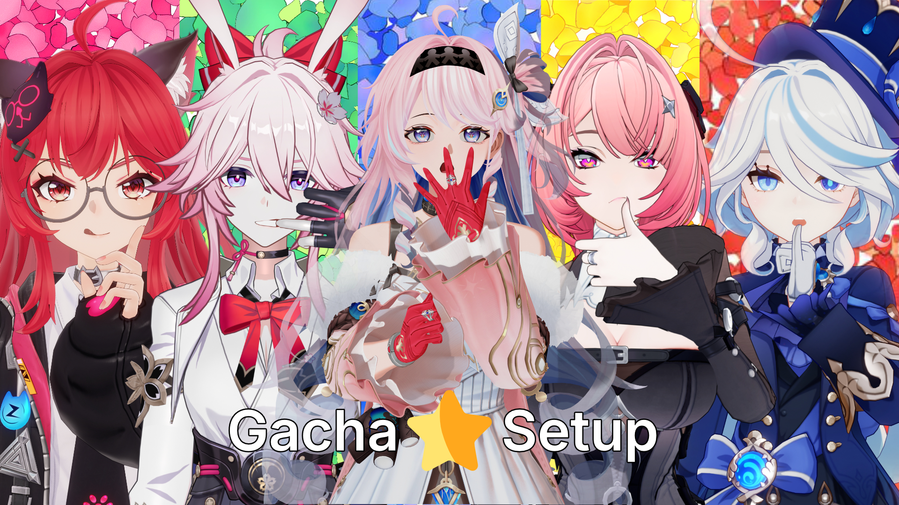

# Gacha Setup for Blender

*Reference: The Quintessential Quintuplets*

**Official Website & Documentation:** [https://gacha-setup.pages.dev/](https://gacha-setup.pages.dev/)

**Gacha Setup** is a fork of the original [Setup Wizard](https://github.com/michael-gh1/Addons-And-Tools-For-Blender-miHoYo-Shaders) add-on, created to provide a simple, automated character setup process for Gacha models. **Blender 5.2 is recommended**, and the add-on is compatible with **Blender/Goo Engine 4.1+**. When using Blender versions **below 4.5**, install **BetterFBX** to import models.

---

## Supported Games

**MMD / PMX:** Genshin's Run Entire Setup accepts a `.pmx` file or a folder containing PMX models when MMD Tools is installed. It adapts the embedded materials, humanoid bones and facial morphs to the normal game pipeline: the same shader templates, Rigify rig and custom controls, face plate, lighting panel, Light Vectors, outlines and compositing stages used by FBX. Embedded PMX texture assignments are preserved when replacing shaders. Missing game-specific packed lightmaps and ramps use neutral shader settings rather than treating diffuse textures as packed maps. Blender 5+ uses the bundled Retarget; Blender 4.x continues to use Expy-Kit.

* **Genshin Impact**
* **Honkai: Star Rail (HSR)**
* **Zenless Zone Zero (ZZZ)**
* **Neverness to Everness (NTE)**
* **Wuthering Waves (WuWa)**
* **Arknights: Endfield (AKE)**
* **Punishing: Gray Raven (PGR)**
* **Honkai Impact 3rd (HI3)**
* **Honkai: Nexus Anima (HNA)**
* **Silver Palace** *(Soon)*

---

## Installation

1. Download the `Gacha_Setup-<version>.zip` file from the **Releases** page.
2. In Blender 5.2 (recommended) or Blender/Goo Engine 4.1+, go to **Edit > Preferences > Add-ons**. If using Blender below 4.5, install BetterFBX first.
3. Click the drop-down menu in the top right corner and select **Install from Disk...**
4. Select the downloaded `Gacha_Setup-<version>.zip` file.
5. Press **N** in the 3D Viewport to access the `Character Setup Wizard` sidebar panel.

---

## Additional Add-ons

The following add-on dependencies are bundled in the `dependencies` directory and are **automatically installed** when missing. They may remain disabled: Gacha Setup activates them for the operation that needs them and restores their previous state afterward.

* **Retarget**: [KBSBAUDRICE/Retarget](https://github.com/KBSBAUDRICE/Retarget) — Rig conversion on Blender 5.0+.
* **ExpyKit**: [pKrime/Expy-Kit](https://github.com/pKrime/Expy-Kit) — Rig conversion on Blender 4.x.
* **UEFormat**: [h4lfheart/UEFormat](https://github.com/h4lfheart/UEFormat) — Installed for importing Neverness to Everness (NTE) character models.

**MMD Tools** must be installed separately for PMX import and **Utilities → Apply VMD Motion** (Blender 5.0+). It may also remain disabled. Dependencies already enabled by the user remain enabled. Rigify remains enabled for character rig controls.

---

## Disclaimer & Credits

This project is an unofficial community tool built for Blender. 

- **No Game Assets Included:** This repository does NOT contain, host, or distribute any 3D models, textures, or proprietary files from any game. Users are responsible for importing their own legally acquired assets.
- **Trademarks:** All game titles (*Genshin Impact*, *Honkai: Star Rail*, *Zenless Zone Zero*, *Wuthering Waves*, *Neverness to Everness*, *Arknights: Endfield*), logos, and character names are registered trademarks of their respective owners (miHoYo / HoYoverse, Kuro Games, Hotta Studio, Perfect World Games, Hypergryph).
- **Affiliation:** This project is an independent community tool and is not affiliated with, sponsored by, or endorsed by the game publishers or studios mentioned above.

---

## License and Attribution

This project is a derivative work modified in 2026 and distributed under the GNU General Public License v3 (GPL v3).

- Original Repository & Author: [michael-gh1/Addons-And-Tools-For-Blender-miHoYo-Shaders](https://github.com/michael-gh1/Addons-And-Tools-For-Blender-miHoYo-Shaders)

### Original Project Credits & Acknowledgments

Thanks to all those who collaborated on the original project:

* [@Festivity](https://github.com/festivities) — [YouTube](https://www.youtube.com/channel/UCXCTHNBA8TVs0s5aQuNtWwg) | [Twitter](https://x.com/festivizing)
* TheyCallMeSpy
* Sultana
* M4urlcl0
* Modder4869
* [@BonnyAnimations](https://github.com/BonnyAnimations) — [YouTube](https://www.youtube.com/@BonnyAnimations) | [Twitter](https://x.com/BonnyTweetsOFF)
* Enthralpy — [YouTube](https://www.youtube.com/@Enthralpy) | [Twitter](https://x.com/Enthralpy)
* [@OctavoPE](https://github.com/OctavoPE) — [Twitter](https://x.com/Llama3D)
* [@nytsjared](https://github.com/nytsjared) — WuWa & PGR Shader
* SubutaiProduction — [YouTube](https://www.youtube.com/@SubutaiProduction) | [Twitter](https://twitter.com/SubutaiEdits)
* Aiko — [YouTube](https://www.youtube.com/@AikoDesu) | [Twitter](https://x.com/Aiko__ya)

### Additional Credits & Acknowledgments (This Project)

* **Mken** — Original creator of Character Setup Wizard
* **Meliodas**
* **Manashiku**
* **Xiyang** — AKE setup
* **starriia** — Model references
* **VaSTuan** — Multi-character support
* **zmecyyyy** — Rig review
* **crabnuts** — Rig reference
* **[nomianims](https://x.com/nomianims)**
* **[emy_purpl](https://x.com/emy_purpl)** — [YouTube](https://www.youtube.com/@emypurpl) · [X](https://x.com/emy_purpl)
* **ae_gm** — Genshin weapon reviewer
* **stalomeow** — HNA Shader
* **max** — HI3 Shader
* **poke** — ZZZ setup
* **cocopops** — Lights+
* **[aeo](https://www.youtube.com/@aeo_346)**
* **JARP3X** — Apply VMD Motion
* **Genshin Impact**:
  * **Shader**: [Blender-miHoYo-Shaders](https://github.com/festivize/Blender-miHoYo-Shaders) by Festivity
  * **Genshin review**: VANS
  * **Pupil Highlight**: nedarb183
* **HSR**:
  * **Shader**: [Blender-StellarToon](https://github.com/festivities/Blender-StellarToon) by Festivity
  * **Face Rig**: Isaac / Just_ScaasI
* **ZZZ**:
  * **Shader**: Kytherity, Just_ScaasI, BonnyAnimations, Aiko
  * **Rigging + Scripting**: Enthralpy
  * **Supervised and made possible by**: Stormz67
  * **ZZZ Tools & Rigging**: [@jideeh](https://github.com/Jideeh1)
    * **Poke / Enthralpy**: Driver Logic
    * **Isaac / Just_ScaasI**: Facerig Logic + Widgets
    * **The_Crabnuts / Kan_Natto**: Facerig Logic + Widgets
* **NTE**:
  * **Rig**: 矩阵映画
* **WuWa / Wuthering Waves**:
  * **Shader**: [Gustling Waters](https://github.com/nytsjared/Gustling-Waters) by [@nytsjared](https://github.com/nytsjared)
  * **Base Addon & Rigging**: [Blender-WuWa-Character-Setup](https://github.com/fnoji/Blender-WuWa-Character-Setup) by [@fnoji](https://github.com/fnoji)
  * **Face Rig**: Akatsuki
* **AKE / Arknights: Endfield**:
  * **Setup**: Xiyang
  * **Shader**: Endfield PBRToon
  * **Face Rig**: Isaac (adaptation)
* **Hair & Clothes Physics**:
  * [thewindlead](https://www.youtube.com/@thewindlead)
* **Assets**:
  * **Hiragara**: Character assets & beta tester
  * **HoyoToon**: Assets · [Discord](https://discord.com/invite/hoyotoon)
* **Logo Icon**: <a href="https://www.flaticon.com/free-icons/star" title="star icons">Star icons created by Magnific - Flaticon</a>

---

## Summary of Key Modifications & Features

In compliance with Section 5a of the GNU General Public License v3, the following primary modifications and major features have been implemented:

- **Blender 5.x Full Support**:
  - Added support and compatibility fixes for Blender 5.2+.
  - Dynamically queries active armature bone collections for interactive N-panel **Rig Layers UI** (with visibility toggles and solo star $\star$ buttons).
  - Resolved null pointer crashes, updated legacy Python API calls, and cleaned up final setup operations.
- **Honkai: Star Rail (HSR) Rigging & Texture Pipeline**:
  - Integrated complete HSR character rigging and automatic texture loading pipelines.
  - Corrected finger, arm, torso, and hip bone rotations/hierarchies.
  - Implemented advanced eye tracking controls and a dynamic eye Y-location driver system to prevent eye popping and mesh clipping during shape key expressions.
- **Zenless Zone Zero (ZZZ) Model & Rigging Suite**:
  - Added full support for importing and setting up ZZZ models with custom breast/breath physics controls (`Torso (IK)`).
  - Integrated the specialized ZZZ facial rig (v6) with advanced shapekey drivers and eye tracking by jideeh.
  - Corrected shoulder widget roll rotations and repositioned thigh parent controls.
  - Automated character collection/armature renaming and `lights` collection handling with native completion status popups.
- **Neverness to Everness (NTE) Support**:
  - Integrated complete character importing, UEFormat support, material assignment, outline setup, and compositor post-processing node configuration.
- **Shader, Outline & Material Fixes**:
  - Fixed broken outline rendering, eyeshadow, and outline line thickness across Genshin, ZZZ, and HSR models.
  - Enhanced post-processing execution and automated texture binding for both manual and standard imports.
- **Codebase Refactoring & Streamlining**:
  - Removed Punishing: Gray Raven (PGR) support during an earlier cleanup; it has since been restored. Stopped bundling older third-party dependencies such as BetterFBX and the legacy auto-updater. BetterFBX must be installed separately when using Blender below 4.5.
